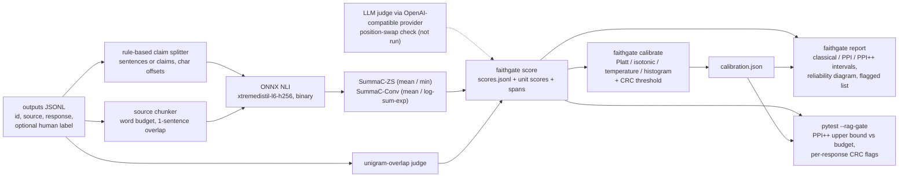

# rag-faithfulness-ppi-gate

A statistical check on how often a RAG system makes things up. A cheap judge (SummaC-style NLI
with a 13M-parameter model, or a unigram-overlap baseline) scores every response; a small random
sample of human labels corrects the judge's bias through prediction-powered inference (PPI/PPI++);
the result is a confidence interval on the hallucination rate, and a pytest plugin fails the build
when its upper bound exceeds a budget. The judges are meta-evaluated and calibrated against the
word-level hallucination spans of RAGTruth.

> **Status of the numbers.** Every results table below is a placeholder marked *pending
> benchmark*. The full benchmark has not been run yet; it runs as one command (see
> [Reproducing the numbers](#reproducing-the-numbers)) and writes `bench/results/full.json`, from
> which `uv run python -m bench.tables bench/results/full.json` prints these tables. The committed
> `bench/results/smoke-*.json` comes from a 36-response smoke run that only proves the harness
> works; its numbers are not results.

## What the interval guarantees

Take a batch of N + n responses from your system. A human labels n of them, chosen **uniformly at
random from the batch**; the judge scores all of them. Write Y for the human label (1 =
hallucinated) and f for the judge's calibrated probability. The quantity of interest is the
batch's hallucination rate, theta = E[Y], as the annotators define a hallucination.

| estimator | point estimate | what it needs |
|---|---|---|
| classical | mean of Y over the n labels | labels only |
| PPI | mean f over the N unlabelled + mean (Y - f) over the n labelled | labels + judge |
| PPI++ | mean (Y - lambda f) over the labelled + lambda mean f over the unlabelled, lambda = Cov(Y, f) / ((1 + n/N) Var f) | labels + judge |
| judge only | mean f over everything | judge only, **no guarantee** |

**Guarantee.** If the labelled responses are a uniform random subset of the batch and the judge
(including its calibrator) was fixed before those labels were seen, then the classical, PPI and
PPI++ intervals cover theta with probability approaching the nominal level as n grows. This holds
however biased the judge is: bias moves the point where the judge alone would land, not the
validity of PPI. A better judge only makes the interval narrower. The gate uses the one-sided
PPI++ upper bound.

**What it does not cover.**

* Labels picked by hand ("the ones that looked wrong") or from a different batch: the correction
  term is then biased and so is the interval.
* Small n: these are CLT intervals. The gate refuses to compute a bound below `min_labelled`
  labels (30 by default), and the coverage table below measures how close to nominal the
  intervals are at n = 50 to 500 on real data.
* Label noise: theta is the rate of hallucinations *as your annotators mark them*.

**The per-response flags** come from conformal risk control (CRC) on a separate labelled
calibration set: the flag threshold t is the largest one with (n R_n(t) + 1) / (n + 1) <= alpha,
where R_n is the share of calibration responses that are hallucinated and unflagged. For a new
response exchangeable with the calibration set, the expected share of responses that are
hallucinated and pass unflagged is then at most alpha. A `miss` variant bounds the miss rate among
hallucinated responses instead.

## Coverage against the number of human labels

Experiment: the 2,700 responses of RAGTruth's test split form the batch. For each n, n responses
are drawn at random as "labelled" and the rest keep only the judge's probability; this is repeated
1,000 times and each interval is checked against the true rate of the whole split. Nominal
two-sided coverage 0.90; nominal one-sided upper-bound coverage 0.95. The judge's isotonic
calibrator is fitted on RAGTruth train, so it is independent of the labels it is corrected with.

*Pending benchmark.* Columns: labelled n, estimator (classical, PPI, PPI++, judge only), empirical
coverage, mean interval width, upper-bound coverage, mean lambda, and the number of human labels
the classical interval would need to match the PPI++ width.

| labelled n | estimator | coverage | mean width | upper-bound coverage | mean lambda |
|---|---|---|---|---|---|
| pending benchmark | | | | | |

The same table for the overlap judge, and for the NLI judge's raw (uncalibrated) score, is in
`bench/results/full.json` under `ppi.by_judge`.

## Add the gate to your CI in three lines

With the package installed in the test environment (`uv add --dev <path or git URL of this
repo>`), a labelled calibration set scored and calibrated once (`faithgate calibrate`), and a
`rag-gate.toml` next to your tests:

```yaml
- run: uv run faithgate fetch model
- run: uv run faithgate score outputs.jsonl --judge nli-zs-min -o scores.jsonl
- run: uv run pytest --rag-gate rag-gate.toml
```

```toml
[rag_gate]
scores = "scores.jsonl"           # rows with a "label" field count as the human-labelled sample
calibration = "calibration.json"  # calibrator + CRC threshold from `faithgate calibrate`
max_rate = 0.10                   # fail when the upper bound exceeds this
confidence = 0.95                 # one-sided level of the upper bound
estimator = "ppi++"               # or "ppi", "classical"
per_response = true               # one test item per response, failing above the CRC threshold
```

pytest then reports `rag_gate_rate` plus one `rag_gate_response[<id>]` item per response, and a
summary section:

```
================================== rag-gate ===================================
rate (ppi++, lambda 0.72): estimate 0.243, 90% upper bound 0.444, budget 0.600 -> pass [8 labelled, 8 unlabelled]
```

(That line is the toy example in `examples/`, scored with the overlap judge; it shows the format,
not a result.) `-k rag_gate_rate` selects the rate check alone; without `--rag-gate` the plugin
adds nothing.

## How the pieces fit



Everything in the boxes is implemented in `src/faithgate/`: the splitter and chunker
(`text.py`), SummaC zero-shot and Conv aggregation (`summac.py`), span localisation (`spans.py`),
the four calibrators with ECE, MCE and Brier (`calibration.py`), classical/PPI/PPI++ (`ppi.py`),
conformal risk control (`conformal.py`), stratified bootstrap (`bootstrap.py`), Cohen's kappa and
Krippendorff's alpha (`metrics.py`), the LLM judge and its provider (`judges.py`, `llm.py`) and the
pytest plugin (`pytest_plugin.py`). scikit-learn is used only in tests, as a parity reference.

## Judges measured against RAGTruth

Setup: RAGTruth test (2,700 responses from 6 LLMs over QA, summarisation and data-to-text; a
response counts as hallucinated when annotators marked any span). Calibrators, Conv weights,
F1 thresholds and span thresholds are fitted on a stratified slice of RAGTruth train; the chunk
budget and the primary NLI judge are chosen on a separate dev slice of train. Test is used once.
Baselines: unigram overlap, uncalibrated NLI at 0.5, and always-hallucinated.

Measured on: Intel i5-8500 (6 cores), 12 GB RAM, Windows 10, CPU only. Date: pending benchmark.

### Response level

*Pending benchmark.* Per judge: AUROC with a stratified-bootstrap 95% CI, F1 of the raw score at
0.5, precision/recall/F1 at the threshold tuned on train, ECE raw and after isotonic calibration,
Brier score.

| judge | AUROC [95% CI] | F1 raw@0.5 | P tuned | R tuned | F1 tuned | ECE raw | ECE isotonic | Brier |
|---|---|---|---|---|---|---|---|---|
| pending benchmark | | | | | | | | |

### Calibration

*Pending benchmark.* ECE, MCE, Brier and F1 at 0.5 for no calibration, Platt, isotonic,
temperature and histogram binning, plus one isotonic calibrator per task type (hallucination base
rates differ sharply between QA, summaries and data-to-text in RAGTruth). A reliability diagram of
the primary judge, raw against isotonic, is written next to the results as
`bench/results/full-reliability.svg`.

| calibration | ECE | MCE | Brier | F1 at 0.5 |
|---|---|---|---|---|
| pending benchmark | | | | |

### Per task type

| task | n | hallucinated share | AUROC NLI | AUROC overlap | F1 tuned | ECE raw | ECE isotonic (global) | ECE isotonic (per task) |
|---|---|---|---|---|---|---|---|---|
| pending benchmark | | | | | | | | |

### Span localisation

Character-level precision, recall and F1 against the annotated spans, micro-averaged over all test
responses. A flagged unit (sentence or claim) is either returned whole or narrowed to the words
that never occur in the source.

| span predictor | unit threshold | char precision | char recall | char F1 |
|---|---|---|---|---|
| pending benchmark | | | | |

### Conformal flags on real data

Two checks per loss and alpha: the threshold calibrated on train and applied to test, and 500
random splits of test into 500 calibration and 2,200 evaluation responses, where exchangeability
holds by construction.

| risk | alpha | threshold (train) | test risk | test flag rate | mean risk, resampled | mean flag rate, resampled |
|---|---|---|---|---|---|---|
| pending benchmark | | | | | | |

### Agreement and throughput

Cohen's kappa of each judge's decisions against the human labels, Krippendorff's alpha across
humans and judges, and judge throughput in responses per second on the i5-8500 (end to end:
splitting, chunking, tokenising and NLI).

| judge | responses timed | responses/s | NLI pairs/s |
|---|---|---|---|
| pending benchmark | | | |

### LLM judge

Not run. `LLMJudge` asks an OpenAI-compatible endpoint (OpenAI, Ollama, vLLM, LM Studio) twice
per response, with the SOURCE and RESPONSE blocks in both orders; disagreeing verdicts become a
0.5 score marked inconsistent, so position bias shows up as uncertainty. It is exercised only by
tests with a scripted provider, and there are no LLM numbers in this repository.

## Reproducing the numbers

```bash
export FAITHGATE_DATA_DIR=/path/with/space   # default: ~/.cache/rag-faithfulness-ppi-gate
uv sync
uv run faithgate fetch ragtruth     # 2 files, 36 MB, sha256-checked
uv run faithgate fetch model        # ONNX model + tokenizer, 52 MB, into the Hugging Face cache
uv run python -m bench.run --profile full
uv run python -m bench.tables bench/results/full.json
```

The full profile NLI-scores a 150-response dev slice under four chunk configurations, a
1,200-response calibration slice of train and all 2,700 test responses, then runs the
experiments. On the i5-8500 that is expected to take under an hour (an estimate from the smoke
run; the measured time is written to `timings_seconds.total`). NLI rows are cached in
`$FAITHGATE_DATA_DIR/nli-cache`, so an interrupted run resumes. `--profile smoke` runs the same
code on 36 test responses in about a minute.

## Quick start

From a checkout, without downloading anything (overlap judge on the toy data in `examples/`):

```bash
uv sync
uv run faithgate score examples/outputs.jsonl --judge overlap -o examples/out/scores.jsonl
uv run faithgate score examples/calibration.jsonl --judge overlap -o examples/out/calibration-scores.jsonl
uv run faithgate calibrate examples/out/calibration-scores.jsonl --method platt --alpha 0.2 -o examples/out/calibration.json
uv run faithgate report examples/out/scores.jsonl --calibration examples/out/calibration.json --out-dir examples/out/report
cd examples && uv run pytest --rag-gate rag-gate.toml
```

With the NLI judge, after `uv run faithgate fetch model`, use `--judge nli-zs-min` or
`--judge nli-zs-mean`. For SummaC-Conv, score a labelled set with `--keep-matrix`, train with
`faithgate train-conv`, then score with `--judge nli-conv --conv conv.json`. To try PPI on real
data, `faithgate export-ragtruth --split test --keep-labels 200 -o test.jsonl` writes the test
split with labels kept on a random 200.

Input rows are JSON objects with `id`, `source`, `response` and optionally `label` (1 =
hallucinated), `spans` and `task_type`. The Docker image runs the same CLI:
`docker build -t faithgate . && docker run --rm faithgate --help`.

## Data and model licences

* **RAGTruth** (ParticleMedia/RAGTruth, commit `c103204`), MIT licence. Downloaded from the
  official GitHub repository by `faithgate fetch ragtruth`, verified against the sha256 values in
  `src/faithgate/assets.py`, never committed.
* **NLI model**: `MoritzLaurer/xtremedistil-l6-h256-zeroshot-v1.1-all-33` (revision `c07f66d`),
  MIT licence, fine-tuned from `microsoft/xtremedistil-l6-h256-uncased` (MIT). Its training mix
  includes NLI and classification datasets under their own licences; see the model card. Fetched
  into the Hugging Face cache, sha256-checked, never committed.
* The toy data in `examples/` was written for this repository.

## Limitations

* The NLI model is small. A response sentence that combines facts from two parts of the source is
  not entailed by any single chunk and looks unsupported; long abstractive summaries suffer most.
  That is why the overlap baseline is reported next to it.
* Response-level labels collapse RAGTruth's span types, including spans annotated as "implicitly
  true" and those caused by null fields in the Yelp records; the judges are scored against that
  definition.
* Calibrators and CRC thresholds fitted on RAGTruth train transfer only to outputs that look like
  RAGTruth. For your own system, fit them on your own labelled outputs.
* PPI and CRC guarantees are marginal (on average over random label draws and calibration sets),
  not conditional on a task type or a single response.
* Span localisation is a heuristic on top of unit scores; it does not model the span boundaries
  annotators drew.
* All measurements come from one Windows machine without a GPU.

## Development

```bash
uv run pytest                      # default suite: no network, no downloads
uv run pytest -m integration       # needs the fetched data and model
uv run ruff check . && uv run ruff format --check .
```

The default suite checks the metrics and the isotonic fit against scikit-learn, monotonicity of
isotonic outputs and PPI/PPI++ coverage on simulated judges with known bias (with hypothesis where
there is an invariant), the CRC risk bound by seeded simulation, Krippendorff's alpha against the
published worked example, the OpenAI-compatible adapter against a local HTTP server, and the pytest
plugin through `pytester`. Design decisions are recorded in [`docs/adr`](docs/adr).

## Licence

MIT, see [LICENSE](LICENSE).
