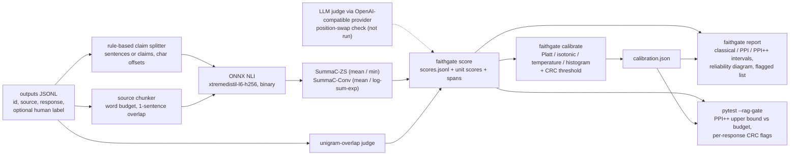

# rag-faithfulness-ppi-gate

A statistical check on how often a RAG system makes things up. A cheap judge (SummaC-style NLI
with a 13M-parameter model, or a unigram-overlap baseline) scores every response; a small random
sample of human labels corrects the judge's bias through prediction-powered inference (PPI/PPI++);
the result is a confidence interval on the hallucination rate, and a pytest plugin fails the build
when its upper bound exceeds a budget. The judges are meta-evaluated and calibrated against the
word-level hallucination spans of RAGTruth.

> **What the benchmark found.** On RAGTruth's 2,700 test responses the PPI and PPI++ intervals
> cover the true hallucination rate at close to the nominal level with every judge tried, which is
> the part the gate relies on. The judges themselves are weak. The unigram-overlap baseline ranks
> hallucinated responses better than every NLI variant built here (AUROC 0.798 against 0.707 for
> the best one). Inside a single task type, the NLI judge's AUROC drops to between 0.437 and 0.680.
> So the human labels buy only a little: 50 labels plus the NLI judge give an interval as narrow
> as about 57 labels alone would. Every number below is copied from `bench/results/full.json`.

Measured on an Intel Core i5-8500 (6 cores), 12 GB RAM (11.9 GB reported), Windows 10, CPU only,
Python 3.12.14 and onnxruntime 1.31.0. Run on 2026-10-09 at commit `2744aef` with
`uv run python -m bench.run --profile full`, which took 2,842 s end to end.

## What the interval guarantees

Take a batch of N + n responses from your system. A human labels n of them, chosen **uniformly at
random from the batch**; the judge scores all of them. Write Y for the human label (1 =
hallucinated) and f for the judge's calibrated probability. The quantity of interest is the
batch's hallucination rate, theta = E[Y], as the annotators define a hallucination.

| estimator | point estimate | what it needs |
|---|---|---|
| classical | mean of Y over the n labels | labels only |
| PPI | mean f over the N unlabelled + mean (Y - f) over the n labelled | labels + judge |
| PPI++ | mean (Y - lambda f) over the labelled + lambda mean f over the unlabelled, lambda = Cov(Y, f) / ((1 + n/N) Var f) | labels + judge |
| judge only | mean f over everything | judge only, **no guarantee** |

**Guarantee.** If the labelled responses are a uniform random subset of the batch and the judge
(including its calibrator) was fixed before those labels were seen, then the classical, PPI and
PPI++ intervals cover theta with probability approaching the nominal level as n grows. This holds
however biased the judge is: bias moves the point where the judge alone would land, not the
validity of PPI. A better judge only makes the interval narrower. The gate uses the one-sided
PPI++ upper bound.

**What it does not cover.**

* Labels picked by hand ("the ones that looked wrong") or from a different batch: the correction
  term is then biased and so is the interval.
* Small n: these are CLT intervals. The gate refuses to compute a bound below `min_labelled`
  labels (30 by default), and the coverage table below measures how close to nominal the
  intervals are at n = 50 to 500 on real data.
* Label noise: theta is the rate of hallucinations *as your annotators mark them*.

**The per-response flags** come from conformal risk control (CRC) on a separate labelled
calibration set: the flag threshold t is the largest one with (n R_n(t) + 1) / (n + 1) <= alpha,
where R_n is the share of calibration responses that are hallucinated and unflagged. For a new
response exchangeable with the calibration set, the expected share of responses that are
hallucinated and pass unflagged is then at most alpha. A `miss` variant bounds the miss rate among
hallucinated responses instead.

## Coverage against the number of human labels

Experiment: the 2,700 responses of RAGTruth's test split form the batch. For each n, n responses
are drawn at random as "labelled" and the rest keep only the judge's probability; this is repeated
1,000 times and each interval is checked against the true rate of the whole split, which is
0.349. Nominal two-sided coverage is 0.90 and nominal one-sided upper-bound coverage is 0.95. The
judge is `nli-conv-max`, the NLI judge chosen on the dev slice (see below). Its isotonic calibrator
is fitted on RAGTruth train, so it is independent of the labels it is corrected with.

| labelled n | estimator | coverage (nominal 0.90) | mean CI width | upper-bound coverage (nominal 0.950) | mean lambda |
|---|---|---|---|---|---|
| 50 | classical | 0.890 | 0.222 | 0.925 |  |
| 50 | ppi | 0.902 | 0.210 | 0.937 | 1.00 |
| 50 | ppi++ | 0.892 | 0.208 | 0.933 | 0.82 |
| 50 | judge-only | 0.000 | 0.012 | 1.000 |  |
| 100 | classical | 0.910 | 0.157 | 0.950 |  |
| 100 | ppi | 0.893 | 0.148 | 0.953 | 1.00 |
| 100 | ppi++ | 0.894 | 0.148 | 0.953 | 0.82 |
| 100 | judge-only | 0.000 | 0.012 | 1.000 |  |
| 200 | classical | 0.906 | 0.111 | 0.948 |  |
| 200 | ppi | 0.912 | 0.105 | 0.952 | 1.00 |
| 200 | ppi++ | 0.913 | 0.105 | 0.951 | 0.78 |
| 200 | judge-only | 0.000 | 0.012 | 1.000 |  |
| 500 | classical | 0.936 | 0.070 | 0.974 |  |
| 500 | ppi | 0.940 | 0.068 | 0.970 | 1.00 |
| 500 | ppi++ | 0.941 | 0.067 | 0.973 | 0.70 |
| 500 | judge-only | 0.000 | 0.012 | 1.000 |  |

The labelled-only interval would need this many labels to be as narrow as PPI++ with n labels.
The columns are the three judges the experiment ran with:

| labelled n | nli-conv-max (isotonic) | nli-conv-max (raw score) | overlap (isotonic) |
|---|---|---|---|
| 50 | 57 | 57 | 66 |
| 100 | 113 | 113 | 131 |
| 200 | 224 | 223 | 258 |
| 500 | 552 | 551 | 624 |

How to read it:

* **Validity holds.** Across n and judges, two-sided coverage of classical, PPI and PPI++ lies
  between 0.886 and 0.941.
* **The one-sided bound is slightly optimistic at small n.** The gate uses the one-sided bound.
  Against a nominal 0.95, its coverage is 0.925 to 0.940 at n = 50 and 0.939 to 0.953 at
  n = 100. From n = 200 it is at least 0.948. These are CLT intervals, so with fewer than about
  200 labels, treat the bound as a little lenient.
* **Over-coverage at n = 500 is expected.** Drawing 500 of 2,700 responses without replacement
  makes the sample mean less variable than the interval assumes, because it carries no
  finite-population correction. The interval is therefore conservative there.
* **The judge alone is biased.** The judge-only interval covered the true rate in none of the
  1,000 draws. Its calibrator learned the base rate of the train slice (0.421), so its upper bound
  sits at 0.415 against a true 0.349. Correcting that kind of shift is what the labelled sample is
  for.
* **The width gain is small because the judges are weak.** PPI++ narrows the interval only as far
  as the judge predicts the label. At n = 50 the width drops from 0.222 to 0.208 with the NLI
  judge, and to 0.193 with the overlap judge.

The overlap judge's full coverage table is in `bench/results/full.json` under `ppi.by_judge`.

## Add the gate to your CI in three lines

You need three things in place first. Install the package in the test environment (`uv add --dev
<path or git URL of this repo>`). From a labelled calibration set, produce `conv.json` and
`calibration.json` once with `faithgate train-conv` and `faithgate calibrate` (see
[Quick start](#quick-start)). Then put a `rag-gate.toml` next to your tests:

```yaml
- run: uv run faithgate fetch model
- run: uv run faithgate score outputs.jsonl --judge nli-conv --conv conv.json -o scores.jsonl
- run: uv run pytest --rag-gate rag-gate.toml
```

This is the NLI judge chosen on the dev slice. On RAGTruth test, the unigram-overlap judge ranked
responses better, and it needs no model. With `--judge overlap` you can drop the first line. The
interval is valid with either judge; a better judge only makes it narrower.

```toml
[rag_gate]
scores = "scores.jsonl"           # rows with a "label" field count as the human-labelled sample
calibration = "calibration.json"  # calibrator + CRC threshold from `faithgate calibrate`
max_rate = 0.10                   # fail when the upper bound exceeds this
confidence = 0.95                 # one-sided level of the upper bound
estimator = "ppi++"               # or "ppi", "classical"
per_response = true               # one test item per response, failing above the CRC threshold
```

pytest then reports `rag_gate_rate` plus one `rag_gate_response[<id>]` item per response, and a
summary section:

```
================================== rag-gate ===================================
rate (ppi++, lambda 0.72): estimate 0.243, 90% upper bound 0.444, budget 0.600 -> pass [8 labelled, 8 unlabelled]
```

(That line is the toy example in `examples/`, scored with the overlap judge; it shows the format,
not a result.) `-k rag_gate_rate` selects the rate check alone; without `--rag-gate` the plugin
adds nothing.

## How the pieces fit



Everything in the boxes is implemented in `src/faithgate/`: the splitter and chunker
(`text.py`), SummaC zero-shot and Conv aggregation (`summac.py`), span localisation (`spans.py`),
the four calibrators with ECE, MCE and Brier (`calibration.py`), classical/PPI/PPI++ (`ppi.py`),
conformal risk control (`conformal.py`), stratified bootstrap (`bootstrap.py`), Cohen's kappa and
Krippendorff's alpha (`metrics.py`), the LLM judge and its provider (`judges.py`, `llm.py`) and the
pytest plugin (`pytest_plugin.py`). scikit-learn is used only in tests, as a parity reference.

## Judges measured against RAGTruth

**Setup.**

* **Test set:** RAGTruth test, 2,700 responses from 6 LLMs over QA, summarisation and
  data-to-text. A response counts as hallucinated when annotators marked any span, which gives a
  rate of 0.349.
* **Fitted on train:** calibrators, Conv weights, F1 thresholds and span thresholds are fitted on
  a stratified 1,200-response slice of RAGTruth train.
* **Chosen on dev:** the chunk budget and the primary NLI judge are chosen on a separate
  150-response dev slice of train. Test is used once.
* **Baselines:** unigram overlap, uncalibrated NLI at 0.5, and always-hallucinated.

Measured on an Intel Core i5-8500 (6 cores), 12 GB RAM, Windows 10, CPU only, on 2026-10-09
(commit `2744aef`, profile `full`).

### Chunking and judge chosen on dev

Each candidate is scored by dev AUROC under both zero-shot aggregations. Claim units against
25-word chunks with a one-sentence overlap won narrowly over sentence units, so all NLI judges use
it. Among the four NLI judges, the dev AUROCs were 0.709 for `nli-zs-mean`, 0.668 for
`nli-zs-min`, 0.644 for `nli-conv-mean` and 0.710 for `nli-conv-max`, so `nli-conv-max` is the
primary judge below. That is SummaC-Conv with log-sum-exp pooling. The `score` command's defaults
(`--unit claim --chunk-words 25 --judge nli-zs-mean`) follow the same dev results.

| config | dev AUROC zs-mean | dev AUROC zs-min | NLI pairs per response |
|---|---|---|---|
| sentence-w25-o1 | 0.706 | 0.681 | 190.0 |
| sentence-w60-o1 | 0.641 | 0.633 | 87.0 |
| sentence-w150-o1 | 0.582 | 0.684 | 26.0 |
| claim-w25-o1 | 0.709 | 0.668 | 211.7 |

### Response level

Each judge is scored on:

* AUROC with a stratified-bootstrap 95% CI
* F1 of the raw score at 0.5
* precision, recall and F1 at the threshold tuned on train
* ECE, raw and after isotonic calibration
* Brier score, raw and after isotonic calibration

| judge | AUROC [95% CI] | F1 raw@0.5 | P tuned | R tuned | F1 tuned | ECE raw | ECE isotonic | Brier raw -> isotonic |
|---|---|---|---|---|---|---|---|---|
| nli-zs-mean | 0.676 [0.655, 0.697] | 0.563 | 0.405 | 0.924 | 0.564 | 0.182 | 0.064 | 0.245 -> 0.213 |
| nli-zs-min | 0.698 [0.680, 0.717] | 0.539 | 0.447 | 0.835 | 0.582 | 0.536 | 0.070 | 0.508 -> 0.208 |
| nli-conv-mean | 0.625 [0.604, 0.646] | 0.403 | 0.404 | 0.871 | 0.552 | 0.072 | 0.069 | 0.223 -> 0.227 |
| nli-conv-max | 0.707 [0.686, 0.726] | 0.526 | 0.428 | 0.862 | 0.572 | 0.067 | 0.066 | 0.206 -> 0.206 |
| overlap | 0.798 [0.783, 0.815] | 0.354 | 0.546 | 0.801 | 0.649 | 0.075 | 0.066 | 0.182 -> 0.176 |
| always-hallucinated | 0.500 [0.500, 0.500] | 0.518 | 0.349 | 1.000 | 0.518 | 0.651 | n/a | 0.651 |
| llm (position-swapped) | not run | not run | not run | not run | not run | not run | not run | not run |

What the table shows:

* **The baseline wins.** On every ranking and decision metric, the overlap baseline beats every
  NLI judge. Its AUROC is 0.798 [0.783, 0.815] against 0.707 [0.686, 0.726], and its F1 at the
  tuned threshold is 0.649 against 0.572. The two bootstrap intervals do not overlap.
* **Uncalibrated NLI is close to flagging everything.** Read as probabilities and cut at 0.5, the
  zero-shot scores reach F1 0.539 to 0.563, barely above flagging every response (0.518).
* **On test the dev ranking reverses slightly.** `nli-zs-min` (0.698) comes out close to
  `nli-conv-max`, and `nli-zs-mean` falls behind both. The choice made on dev stands.

### Calibration

The calibrators are compared on the primary judge, `nli-conv-max`:

* **Zero-shot scores need calibrating.** They are not probabilities. Isotonic calibration takes
  ECE from 0.182 to 0.064 for `nli-zs-mean` and from 0.536 to 0.070 for `nli-zs-min`.
* **SummaC-Conv barely moves.** It is trained with a logistic loss, so it starts out near
  calibrated (ECE 0.067). Post-hoc methods leave it between 0.057 and 0.066.
* **Per-task calibrators mostly learn base rates.** With one isotonic calibrator per task type,
  the pooled ECE goes up to 0.084 while Brier falls to 0.188 and F1 at 0.5 rises to 0.640. Most
  of that gain comes from the three tasks' base rates (0.178, 0.227 and 0.643), not from the NLI
  score.

The reliability diagram (raw against isotonic) is in
[`bench/results/full-reliability.svg`](bench/results/full-reliability.svg).

| calibration | ECE | MCE | Brier | F1 at 0.5 |
|---|---|---|---|---|
| none | 0.067 | 0.125 | 0.206 | 0.526 |
| platt | 0.064 | 0.306 | 0.206 | 0.535 |
| isotonic | 0.066 | 0.497 | 0.206 | 0.549 |
| temperature | 0.057 | 0.206 | 0.205 | 0.526 |
| histogram | 0.063 | 0.102 | 0.205 | 0.553 |
| isotonic, one per task type | 0.084 |  | 0.188 | 0.640 |

### Per task type

| task | n | hallucinated share | AUROC nli-conv-max | AUROC overlap | F1 tuned | ECE raw | ECE isotonic (global) | ECE isotonic (per task) |
|---|---|---|---|---|---|---|---|---|
| QA | 900 | 0.178 | 0.680 | 0.763 | 0.360 | 0.169 | 0.151 | 0.107 |
| Summary | 900 | 0.227 | 0.535 | 0.681 | 0.336 | 0.133 | 0.112 | 0.076 |
| Data2txt | 900 | 0.643 | 0.437 | 0.681 | 0.783 | 0.134 | 0.135 | 0.087 |

* **The pooled AUROC overstates how well NLI ranks responses.** The pooled 0.707 is higher than
  every within-task value. Much of it therefore comes from telling apart task types whose base
  rates differ, not from ranking responses within a task.
* **On data-to-text the primary judge is worse than chance,** at 0.437.
* **Overlap is ahead in every task.** Across all four NLI variants, no within-task AUROC exceeds
  0.680, and every overlap value is at least 0.681. The per-variant figures are in
  `meta_eval.<judge>.per_task`.

### Span localisation

Character-level precision, recall and F1 against the annotated spans, micro-averaged over all test
responses. A flagged unit (sentence or claim) is either returned whole or narrowed to the words
that never occur in the source.

| span predictor | unit threshold | char precision | char recall | char F1 |
|---|---|---|---|---|
| nli-conv-max (whole unit) | 0.15 | 0.056 | 0.341 | 0.096 |
| nli-conv-max (source-absent words in flagged units) | 0.15 | 0.075 | 0.189 | 0.108 |
| overlap (unsupported word runs) | 0.65 | 0.147 | 0.236 | 0.181 |
| always-hallucinated (whole response) | n/a | 0.041 | 1.000 | 0.078 |

Annotated spans cover 4.1% of response characters, which is the precision of marking everything.
Every span predictor here is weak. The best, overlap's unsupported word runs, reaches a char F1 of
0.181. Narrowing NLI-flagged units to source-absent words raises precision from 0.056 to 0.075,
at the cost of recall.

### Conformal flags on real data

Two checks per loss and alpha. The first applies the threshold calibrated on train to test. The
second uses 500 random splits of test into 500 calibration and 2,200 evaluation responses, where
exchangeability holds by construction. The judge is `nli-conv-max` after isotonic calibration.

| risk | alpha | threshold (train) | test risk | test flag rate | mean risk, resampled | mean flag rate, resampled |
|---|---|---|---|---|---|---|
| slip | 0.05 | 0.286 | 0.047 | 0.709 | 0.038 | 0.762 |
| slip | 0.10 | 0.338 | 0.048 | 0.704 | 0.067 | 0.633 |
| slip | 0.20 | 0.533 | 0.154 | 0.361 | 0.189 | 0.289 |
| miss | 0.05 | 0.263 | 0.056 | 0.858 | 0.019 | 0.940 |
| miss | 0.10 | 0.263 | 0.056 | 0.858 | 0.060 | 0.851 |
| miss | 0.20 | 0.338 | 0.138 | 0.704 | 0.137 | 0.705 |

* **Within test, the bound holds.** The mean realised risk stays under alpha in all six rows.
* **Across splits, one row misses.** Calibrated on train and applied to test, the slip risk stays
  under alpha, but the miss risk at alpha 0.05 comes out at 0.056. The guarantee is an average
  over calibration draws and assumes exchangeability, and train's base rate (0.421) is not
  test's (0.349).
* **A weak judge flags most responses.** Holding the slip risk at 0.05 means flagging 0.709 of
  test responses for review.

### Agreement and throughput

Agreement is measured on decisions at the F1-tuned thresholds: Cohen's kappa of each judge against
the human labels, and Krippendorff's alpha across humans and judges.

| decisions at the tuned threshold | Cohen's kappa vs human / alpha |
|---|---|
| overlap | 0.399 |
| nli-zs-mean | 0.152 |
| nli-zs-min | 0.233 |
| nli-conv-mean | 0.144 |
| nli-conv-max | 0.197 |
| Krippendorff's alpha, humans + judges | 0.315 |
| Krippendorff's alpha, judges only | 0.391 |

Throughput is measured end to end on the i5-8500: splitting, chunking, tokenising and NLI. The NLI
row is timed on a stratified sample of 150 test responses after a warm-up.

| judge | responses timed | responses/s | NLI pairs/s |
|---|---|---|---|
| NLI (claim-w25-o1) | 150 | 1.52 | 316.3 |
| overlap | 2700 | 807.9 |  |

### LLM judge

Not run. `LLMJudge` sends each response to an OpenAI-compatible endpoint (OpenAI, Ollama, vLLM,
LM Studio) twice, with the SOURCE and RESPONSE blocks in both orders. When the two verdicts
disagree, the response gets a score of 0.5 and is marked inconsistent, so position bias shows up
as uncertainty. Only tests with a scripted provider exercise it, and this repository contains no
LLM numbers.

## Reproducing the numbers

```bash
export FAITHGATE_DATA_DIR=/path/with/space   # default: ~/.cache/rag-faithfulness-ppi-gate
uv sync
uv run faithgate fetch ragtruth     # 2 files, 36 MB, sha256-checked
uv run faithgate fetch model        # ONNX model + tokenizer, 52 MB, into the Hugging Face cache
uv run python -m bench.run --profile full
uv run python -m bench.tables bench/results/full.json
```

The full profile does the following:

* NLI-scores the 150-response dev slice under four chunk configurations
* NLI-scores the 1,200-response calibration slice of train and all 2,700 test responses
* runs the experiments

On the i5-8500 the run took 2,842 s. Of that, the dev grid took 290.6 s, NLI scoring took
2401.6 s and the throughput probe took 103.3 s. Per-stage times are in `timings_seconds`.

NLI rows are cached in `$FAITHGATE_DATA_DIR/nli-cache`, so an interrupted run resumes. `bench.tables`
prints every table in this README from the results file. `--profile smoke` runs the same code on a
36-response test slice as a harness check; its output is not a result.

## Quick start

From a checkout, without downloading anything (overlap judge on the toy data in `examples/`):

```bash
uv sync
uv run faithgate score examples/outputs.jsonl --judge overlap -o examples/out/scores.jsonl
uv run faithgate score examples/calibration.jsonl --judge overlap -o examples/out/calibration-scores.jsonl
uv run faithgate calibrate examples/out/calibration-scores.jsonl --method platt --alpha 0.2 -o examples/out/calibration.json
uv run faithgate report examples/out/scores.jsonl --calibration examples/out/calibration.json --out-dir examples/out/report
cd examples && uv run pytest --rag-gate rag-gate.toml
```

To use the NLI judge, run `uv run faithgate fetch model` first. `score` then defaults to
`--judge nli-zs-mean`, with claim units scored against 25-word chunks; `--judge nli-zs-min` is the
other zero-shot aggregation.

SummaC-Conv is the judge in the CI snippet above. To set it up:

1. Score a labelled set with `--keep-matrix`.
2. Fit the weights with `faithgate train-conv labelled-scores.jsonl -o conv.json`. It uses
   log-sum-exp pooling by default.
3. Score the labelled set again with `--judge nli-conv --conv conv.json`.
4. Pass those scores to `faithgate calibrate`.

To try PPI on real data, `faithgate export-ragtruth --split test --keep-labels 200 -o test.jsonl`
writes the test split with labels kept on a random 200 responses.

Input rows are JSON objects with `id`, `source`, `response` and optionally `label` (1 =
hallucinated), `spans` and `task_type`. The Docker image runs the same CLI:
`docker build -t faithgate . && docker run --rm faithgate --help`.

## Data and model licences

* **RAGTruth** (ParticleMedia/RAGTruth, commit `c103204`), MIT licence. Downloaded from the
  official GitHub repository by `faithgate fetch ragtruth`, verified against the sha256 values in
  `src/faithgate/assets.py`, never committed.
* **NLI model**: `MoritzLaurer/xtremedistil-l6-h256-zeroshot-v1.1-all-33` (revision `c07f66d`),
  MIT licence, fine-tuned from `microsoft/xtremedistil-l6-h256-uncased` (MIT). Its training mix
  includes NLI and classification datasets under their own licences; see the model card. Fetched
  into the Hugging Face cache, sha256-checked, never committed.
* The toy data in `examples/` was written for this repository.

## Limitations

* **The NLI model is small.** A response sentence that combines facts from two parts of the
  source is not entailed by any single chunk, so it looks unsupported.
* **The NLI judges lose to a baseline.** On RAGTruth they rank responses worse than unigram
  overlap. Within a task type their AUROC is at most 0.680, and the primary judge scores 0.437 on
  data-to-text, below chance. The PPI interval stays valid, but with judges this weak it is only
  slightly narrower than a labels-only interval.
* **The dev selection is close.** The chunk configuration and primary judge were chosen on a
  150-response dev slice. The margin between the top two configurations there is small (0.709
  against 0.706), and a larger slice could reverse it.
* **Small label budgets make the gate slightly lenient.** At n = 50 the one-sided upper bound
  covered 0.925 to 0.940 of the time against a nominal 0.95.
* **Low-risk conformal flags flag most responses.** With these judges, holding the slip risk at
  0.05 flags 0.709 of the responses.
* **Labels are response-level.** They collapse RAGTruth's span types, including spans annotated
  as "implicitly true" and those caused by null fields in the Yelp records; the judges are scored
  against that definition.
* **Fitted pieces do not transfer.** Calibrators and CRC thresholds fitted on RAGTruth train fit
  only outputs that look like RAGTruth. For your own system, fit them on your own labelled outputs.
* **The guarantees are marginal.** PPI and CRC hold on average over random label draws and
  calibration sets, not conditionally on a task type or a single response.
* **Spans are heuristic.** Span localisation sits on top of unit scores and does not model the
  span boundaries annotators drew.
* **One machine.** All measurements come from one Windows machine without a GPU.

## Development

```bash
uv run pytest                      # default suite: no network, no downloads
uv run pytest -m integration       # needs the fetched data and model
uv run ruff check . && uv run ruff format --check .
```

The default suite checks the metrics and the isotonic fit against scikit-learn, monotonicity of
isotonic outputs and PPI/PPI++ coverage on simulated judges with known bias (with hypothesis where
there is an invariant), the CRC risk bound by seeded simulation, Krippendorff's alpha against the
published worked example, the OpenAI-compatible adapter against a local HTTP server, and the pytest
plugin through `pytester`. Design decisions are recorded in [`docs/adr`](docs/adr).

## Licence

MIT, see [LICENSE](LICENSE).
