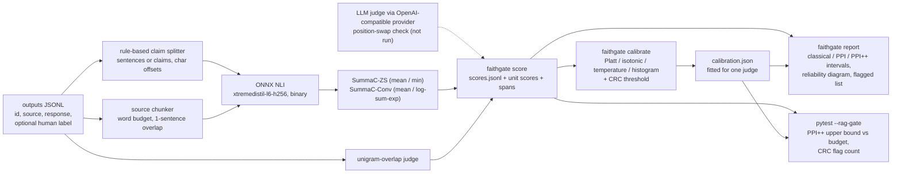

# rag-faithfulness-ppi-gate

A statistical check on how often a RAG system makes things up. A cheap judge (SummaC-style NLI
with a 13M-parameter model, or a unigram-overlap baseline) scores every response; a small random
sample of human labels corrects the judge's bias through prediction-powered inference (PPI/PPI++);
the result is a confidence interval on the hallucination rate, and a pytest plugin fails the build
when its upper bound exceeds a budget. The judges are meta-evaluated and calibrated against the
word-level hallucination spans of RAGTruth.

> **What the benchmark found.** On RAGTruth's 2,700 test responses the classical, PPI and PPI++
> intervals cover the true hallucination rate at close to their nominal level with every judge
> tried. That is the part the gate relies on. The judges themselves are weak, and the NLI ones
> mostly measure length: counting a response's claims, with no model at all, gives an AUROC of
> 0.672, and once task type and length are held fixed the NLI judges fall to between 0.525 and
> 0.593. The unigram-overlap baseline holds up better (0.807 pooled, 0.711 with length held
> fixed). So the human labels carry the estimate. 50 labels plus the primary NLI judge give an
> interval as narrow as 55 labels alone, and a judge that only counts claims does the same.

Every benchmark result below is copied from `bench/results/full.json`. Measured on an Intel Core
i5-8500 with 6 cores and 12 GB of RAM, under Windows 10, CPU only, with Python 3.12.14 and
onnxruntime 1.31.0. The results file is from the run of 2026-10-10 at commit `a3e316e`.

## What the interval guarantees

Take a batch of N + n responses from your system. A human labels n of them, chosen **uniformly at
random from the batch**; the judge scores all of them. Write Y for the human label (1 =
hallucinated) and f for the judge's calibrated probability. The quantity of interest is the
batch's hallucination rate, theta = E[Y], as the annotators define a hallucination.

| estimator | point estimate | what it needs |
|---|---|---|
| classical | mean of Y over the n labels | labels only |
| PPI | mean f over the N unlabelled + mean (Y - f) over the n labelled | labels + judge |
| PPI++ | mean (Y - lambda f) over the labelled + lambda mean f over the unlabelled, lambda = Cov(Y, f) / ((1 + n/N) Var f) | labels + judge |
| judge only | mean f over everything | judge only, **no guarantee** |

If the labelled responses are a uniform random subset of the batch, and the judge (calibrator
included) was fixed before those labels were seen, then the classical, PPI and PPI++ intervals
cover theta with probability approaching the nominal level as n grows. This holds however biased
the judge is. Bias moves the point where the judge alone would land, not the validity of PPI; a
better judge only makes the interval narrower. The gate uses the one-sided PPI++ upper bound.

The guarantee does not survive labels picked by hand ("the ones that looked wrong") or taken from
a different batch, because the correction term is then biased and so is the interval. It is
asymptotic: these are CLT intervals, the gate computes no bound below `min_labelled` labels (30 by
default), and the coverage table below measures how close to nominal they get at n = 50 to 500.
And theta is the rate of hallucinations as your annotators mark them, label noise included.

Per-response flags come from conformal risk control (CRC) on a separate labelled calibration set.
The flag threshold t is the largest one with (n R_n(t) + 1) / (n + 1) <= alpha, where R_n is the
share of calibration responses that are hallucinated and unflagged. For a new response
exchangeable with the calibration set, the expected share of responses that are hallucinated and
pass unflagged is then at most alpha. A `miss` variant bounds the miss rate among hallucinated
responses instead.

## Coverage against the number of human labels

The 2,700 responses of RAGTruth's test split form the batch. For each n, n responses are drawn at
random as "labelled" and the rest keep only the judge's probability. This is repeated 1,000 times
and each interval is checked against the true rate of the whole split, 0.349. Nominal two-sided
coverage is 0.90 and nominal one-sided upper-bound coverage is 0.95. The judge is `nli-zs-mean`,
the NLI judge chosen on the dev slice (see below), with an isotonic calibrator fitted on RAGTruth
train, so it is independent of the labels it is corrected with.

| labelled n | estimator | coverage (nominal 0.90) | mean CI width | upper-bound coverage (nominal 0.95) | mean lambda |
|---|---|---|---|---|---|
| 50 | classical | 0.890 | 0.222 | 0.925 |  |
| 50 | ppi | 0.906 | 0.213 | 0.946 | 1.00 |
| 50 | ppi++ | 0.900 | 0.211 | 0.939 | 0.83 |
| 50 | judge-only | 0.000 | 0.010 | 1.000 |  |
| 100 | classical | 0.910 | 0.157 | 0.950 |  |
| 100 | ppi | 0.895 | 0.151 | 0.950 | 1.00 |
| 100 | ppi++ | 0.893 | 0.150 | 0.948 | 0.84 |
| 100 | judge-only | 0.000 | 0.010 | 1.000 |  |
| 200 | classical | 0.906 | 0.111 | 0.948 |  |
| 200 | ppi | 0.920 | 0.107 | 0.958 | 1.00 |
| 200 | ppi++ | 0.918 | 0.107 | 0.956 | 0.80 |
| 200 | judge-only | 0.000 | 0.010 | 1.000 |  |
| 500 | classical | 0.936 | 0.070 | 0.974 |  |
| 500 | ppi | 0.926 | 0.068 | 0.966 | 1.00 |
| 500 | ppi++ | 0.933 | 0.068 | 0.972 | 0.72 |
| 500 | judge-only | 0.000 | 0.010 | 1.000 |  |

How many labels the labelled-only interval would need to be as narrow as PPI++ with n labels, for
each judge the experiment ran with. The last column is the length baseline (the number of claim
units in the response) put through the same isotonic calibration:

| labelled n | nli-zs-mean (isotonic) | nli-zs-mean (raw score) | overlap (isotonic) | length (isotonic) |
|---|---|---|---|---|
| 50 | 55 | 55 | 67 | 55 |
| 100 | 109 | 110 | 133 | 109 |
| 200 | 217 | 217 | 262 | 217 |
| 500 | 537 | 538 | 632 | 537 |

**The intervals hold their level.** Across the four judges and every n, two-sided coverage of the
classical, PPI and PPI++ intervals lies between 0.886 and 0.936 against a nominal 0.90.

**The one-sided bound is a little lenient below about 200 labels.** Against a nominal 0.95, the
upper bound covered 0.925 to 0.946 of the time at n = 50 and 0.937 to 0.953 at n = 100; from
n = 200 it is at least 0.948. With fewer than about 200 labels, read the gate's bound as slightly
optimistic.

At n = 500 coverage runs above nominal (0.966 to 0.974 for the upper bound). Drawing 500 of 2,700
responses without replacement makes the sample mean less variable than the interval assumes,
since it carries no finite-population correction, so the interval is conservative there. The
judge alone covered the true rate in none of the 1,000 draws: its calibrator learned the base rate
of the train slice (0.421), which puts its upper bound at 0.418 against a true 0.349. Correcting
that kind of shift is what the labelled sample is for.

PPI++ narrows the interval only as far as the judge predicts the label. At n = 50 the width drops
from 0.222 to 0.211 with the NLI judge and to 0.191 with the overlap judge, and the length
baseline buys exactly what the NLI judge buys. The overlap judge's full coverage table is in
`bench/results/full.json` under `ppi.by_judge`.

## Add the gate to your CI in three lines

Before the first run, once and outside CI, label a uniform random sample of your system's outputs
(a `label` field, 1 = hallucinated), then score it and fit the calibrator and the flag threshold.
That sample must not overlap the labels the gate later uses for the rate.

```bash
uv run faithgate score labelled.jsonl --judge overlap -o labelled-scores.jsonl
uv run faithgate calibrate labelled-scores.jsonl -o calibration.json
```

In the workflow, with the package installed as a dev dependency (`uv add --dev <path or git URL of
this repo>`):

```yaml
- run: uv run faithgate score outputs.jsonl --judge overlap -o scores.jsonl
- run: uv run pytest --rag-gate rag-gate.toml
- run: uv run faithgate report scores.jsonl --calibration calibration.json --out-dir rag-report
```

and next to it a `rag-gate.toml`:

```toml
[rag_gate]
scores = "scores.jsonl"          # rows that carry a "label" are the human-labelled sample
calibration = "calibration.json" # calibrator and CRC threshold from `faithgate calibrate`
max_rate = 0.10                  # fail when the upper bound exceeds this
confidence = 0.95                # one-sided level of the upper bound
estimator = "ppi++"              # or "ppi", "classical"
min_labelled = 30                # no bound below this many labels
too_few_labels = "fail"          # "skip" lets the build pass with no rate check at all
per_response = false             # true adds one failing item per flagged response
```

The overlap judge is used here because it ranked RAGTruth responses best and needs no model. For
the NLI judge, add `uv run faithgate fetch model` and drop `--judge overlap`; the interval is
valid with either judge, a better one only makes it narrower. The gate and the report refuse a
`calibration.json` fitted on another judge's scores, so switching judges means calibrating again.

pytest reports one item, `rag_gate_rate`, and a summary section. On the toy data in `examples/`
(see below) it reads:

```
================================== rag-gate ===================================
rate (ppi++, lambda 0.65): estimate 0.245, 90% upper bound 0.444, budget 0.600 -> pass [8 labelled, 8 unlabelled]
5 of 16 responses at or above the flag threshold 0.709 (for review, listed by `faithgate report`)
```

The second line counts the responses at or above the CRC flag threshold. They do not fail the
build by default. With the judges measured below, holding the slip risk at the `calibrate`
default of alpha 0.10 flags 0.713 of RAGTruth test responses, so one failing item per flag would
fail nearly every build. The report from the third workflow line lists them, highest probability
first, as a review queue; `per_response = true` turns each into a failing test item. With fewer
than `min_labelled` labels there is no bound, and `rag_gate_rate` fails unless `too_few_labels =
"skip"`, which leaves the build green without any rate check. `-k rag_gate_rate` selects the gate
alone, and without `--rag-gate` the plugin adds nothing.

## Trying it on the toy data

From a checkout, without downloading anything (overlap judge, the 16 toy outputs in `examples/`):

```bash
uv sync
uv run faithgate score examples/calibration.jsonl --judge overlap -o examples/out/calibration-scores.jsonl
uv run faithgate calibrate examples/out/calibration-scores.jsonl --method platt --alpha 0.2 -o examples/out/calibration.json
uv run faithgate score examples/outputs.jsonl --judge overlap -o examples/out/scores.jsonl
uv run faithgate report examples/out/scores.jsonl --calibration examples/out/calibration.json --out-dir examples/out/report
cd examples && uv run pytest --rag-gate rag-gate.toml
```

`calibrate` prints the ECE after calibration both in-sample and under 5-fold cross-validation;
the in-sample figure is near zero for isotonic by construction, so the cross-validated one is the
one to read.

With `uv run faithgate fetch model` first, `score` defaults to `--judge nli-zs-mean` with claim
units scored against 25-word chunks, the configuration chosen on the dev slice. `--judge
nli-zs-min` is the other zero-shot aggregation. SummaC-Conv needs training on labelled data:
score the labelled set with `--keep-matrix`, fit the filter with `faithgate train-conv
labelled-scores.jsonl -o conv.json` (log-sum-exp pooling by default), score again with `--judge
nli-conv --conv conv.json`, and calibrate those scores.

`faithgate export-ragtruth --split test --keep-labels 200 -o test.jsonl` writes the RAGTruth test
split with labels kept on a random 200 responses, to try PPI on real data. Input rows are JSON
objects with `id`, `source`, `response` and optionally `label`, `spans` and `task_type`. The
Docker image runs the same CLI: `docker build -t faithgate . && docker run --rm faithgate --help`.

## How the pieces fit



Everything in the boxes is implemented in `src/faithgate/`: the splitter and chunker
(`text.py`), SummaC zero-shot and Conv aggregation (`summac.py`), span localisation (`spans.py`),
the four calibrators with ECE, MCE and Brier (`calibration.py`), classical/PPI/PPI++ (`ppi.py`),
conformal risk control (`conformal.py`), stratified bootstrap (`bootstrap.py`), Cohen's kappa,
Krippendorff's alpha and the length-matched AUROC (`metrics.py`), the LLM judge and its provider
(`judges.py`, `llm.py`) and the pytest plugin (`pytest_plugin.py`). scikit-learn is used only in
tests, as a parity reference.

## Judges measured against RAGTruth

The test set is RAGTruth test: 2,700 responses from 6 LLMs over QA, summarisation and
data-to-text, counted as hallucinated when annotators marked any span (a rate of 0.349).
Calibrators, Conv weights, F1 thresholds and span thresholds are fitted on a stratified
1,200-response slice of RAGTruth train. The chunk budget and the primary NLI judge are chosen on a
separate 150-response dev slice of train, and test is used once. The baselines are unigram
overlap, uncalibrated NLI at 0.5, always-hallucinated, and a length baseline: the number of
checkable claim units in the response, which is what the NLI judges pool over.

### Choices made on dev

Each chunking candidate is scored by dev AUROC under both zero-shot aggregations. Claim units
against 25-word chunks with a one-sentence overlap won narrowly over sentence units (0.712 against
0.709), so every NLI judge uses it.

| config | dev AUROC zs-mean | dev AUROC zs-min | NLI pairs per response |
|---|---|---|---|
| sentence-w25-o1 | 0.709 | 0.687 | 190.4 |
| sentence-w60-o1 | 0.642 | 0.635 | 87.2 |
| sentence-w150-o1 | 0.583 | 0.678 | 26.1 |
| claim-w25-o1 | 0.712 | 0.674 | 212.0 |

The primary judge is the NLI judge with the highest dev AUROC, a rule fixed before test was
scored. That is `nli-zs-mean`, ahead of `nli-conv-max` by under two thousandths. The first full run,
made before a splitter fix that stopped sentences merging after "no." and "U.S.", picked
`nli-conv-max` by a similar margin, so treat the choice as close to a coin toss. The
length-matched column (defined below) is reported but not used to choose: on dev it prefers
`nli-conv-mean`, which on test is weaker than `nli-zs-mean` by that same measure (0.538 against
0.593), so 150 dev responses are too few to choose on it (ADR 0005).

| NLI judge | dev AUROC | dev length-matched AUROC |
|---|---|---|
| nli-zs-mean | 0.712 | 0.572 |
| nli-zs-min | 0.674 | 0.441 |
| nli-conv-mean | 0.647 | 0.605 |
| nli-conv-max | 0.711 | 0.586 |

### Ranking responses

AUROC with a stratified-bootstrap 95% CI, pooled and length-matched. The length-matched AUROC
compares each hallucinated response only with faithful responses of the same task type and the
same number of claim units, so a score that merely grows with length gets 0.5.

| judge | AUROC [95% CI] | length-matched AUROC [95% CI] |
|---|---|---|
| nli-zs-mean | 0.676 [0.655, 0.697] | 0.593 [0.561, 0.622] |
| nli-zs-min | 0.698 [0.680, 0.717] | 0.558 [0.528, 0.586] |
| nli-conv-mean | 0.625 [0.604, 0.646] | 0.538 [0.507, 0.568] |
| nli-conv-max | 0.707 [0.687, 0.726] | 0.525 [0.495, 0.556] |
| overlap | 0.807 [0.791, 0.823] | 0.711 [0.684, 0.737] |
| always-hallucinated | 0.500 [0.500, 0.500] | 0.500 [0.500, 0.500] |
| length (unit count, no model) | 0.672 [0.651, 0.691] | 0.500 [0.500, 0.500] |

Most of what the NLI judges rank is length. Pooled over tasks, RAGTruth's longer responses are
more often hallucinated, and the unit count alone reaches 0.672, level with the primary judge's pooled
0.676. Held to the same task and length, the NLI judges keep between 0.525 and 0.593.
`nli-conv-max` loses the most: its log-sum-exp pooling adds about log(units) to the response
logit, so its pooled lead (0.707) is a length effect, and its matched interval [0.495, 0.556]
includes chance. `nli-zs-mean` averages over units instead and keeps 0.593 [0.561, 0.622].

**The overlap baseline ranks best.** It scores the share of a response's content words that the
source never uses, which length barely touches: 0.807 [0.791, 0.823] pooled and 0.711
[0.684, 0.737] matched, ahead of every NLI judge on both, with intervals that do not overlap.

### Decisions and calibration

F1 of the raw score read as a probability and cut at 0.5; precision, recall and F1 at the
threshold tuned on train; ECE and Brier score raw and after isotonic calibration. The length
baseline's score is a count, not a probability, so it has no raw-probability figures.

| judge | F1 raw@0.5 | P tuned | R tuned | F1 tuned | ECE raw | ECE isotonic | Brier raw -> isotonic |
|---|---|---|---|---|---|---|---|
| nli-zs-mean | 0.563 | 0.405 | 0.924 | 0.563 | 0.182 | 0.064 | 0.245 -> 0.213 |
| nli-zs-min | 0.539 | 0.446 | 0.837 | 0.582 | 0.536 | 0.069 | 0.509 -> 0.208 |
| nli-conv-mean | 0.405 | 0.403 | 0.870 | 0.551 | 0.072 | 0.070 | 0.223 -> 0.227 |
| nli-conv-max | 0.529 | 0.424 | 0.867 | 0.569 | 0.065 | 0.065 | 0.206 -> 0.206 |
| overlap | 0.318 | 0.552 | 0.807 | 0.655 | 0.084 | 0.071 | 0.182 -> 0.173 |
| always-hallucinated | 0.518 | 0.349 | 1.000 | 0.518 | 0.651 | n/a | 0.651 |
| length (unit count, no model) | n/a | 0.407 | 0.899 | 0.560 | n/a | 0.067 | n/a -> 0.213 |
| llm (position-swapped) | not run | not run | not run | not run | not run | not run | not run |

At the tuned threshold the overlap baseline has the best precision (0.552 against 0.403 to 0.446
for the NLI judges) and F1 (0.655 against 0.551 to 0.582). It gives up recall for it (0.807
against 0.837 to 0.924). Read as a probability and cut at 0.5 it is the worst judge here (F1
0.318), because a share of unsupported words is not a probability until it is calibrated. The
unit count, at F1 0.560 with a tuned threshold, sits inside the NLI judges' range. Uncalibrated
zero-shot NLI cut at 0.5 (F1 0.539 to 0.563) is barely better than flagging every response
(0.518).

Calibrating the primary judge, `nli-zs-mean`:

| calibration | ECE | MCE | Brier | F1 at 0.5 |
|---|---|---|---|---|
| none | 0.182 | 0.497 | 0.245 | 0.563 |
| platt | 0.066 | 0.550 | 0.214 | 0.433 |
| isotonic | 0.064 | 0.151 | 0.213 | 0.475 |
| temperature | 0.164 | 0.383 | 0.237 | 0.563 |
| histogram | 0.062 | 0.102 | 0.212 | 0.504 |
| isotonic, one per task type | 0.066 |  | 0.189 | 0.622 |

Zero-shot scores are not probabilities. Isotonic calibration takes the ECE from 0.182 to 0.064
and histogram binning to 0.062. Temperature scaling barely helps (0.164): it can only stretch the
logit around 0.5 and cannot move the decision boundary, and this judge's error is mostly a shift.
One isotonic calibrator per task type lowers the Brier score to 0.189 and lifts F1 at 0.5 to
0.622, mostly by learning the three tasks' base rates (0.178, 0.227 and 0.643) rather than
anything in the NLI score. The reliability diagram, raw against isotonic, is
[`bench/results/full-reliability.svg`](bench/results/full-reliability.svg).

### Per task type

| task | n | hallucinated share | AUROC length | AUROC / matched, nli-zs-mean | AUROC / matched, overlap | ECE raw | ECE isotonic (global) | ECE isotonic (per task) |
|---|---|---|---|---|---|---|---|---|
| QA | 900 | 0.178 | 0.682 | 0.612 / 0.591 | 0.778 / 0.783 | 0.244 | 0.155 | 0.123 |
| Summary | 900 | 0.227 | 0.526 | 0.573 / 0.597 | 0.682 / 0.691 | 0.296 | 0.182 | 0.060 |
| Data2txt | 900 | 0.643 | 0.422 | 0.600 / 0.589 | 0.689 / 0.692 | 0.036 | 0.140 | 0.050 |

The pooled AUROC of 0.676 is above every within-task value of the primary judge, so part of it
comes from separating task types with different base rates. Within a task, `nli-zs-mean` stays
between 0.573 and 0.612, and between 0.589 and 0.597 with length matched too. The length signal
itself changes sign by task: longer QA answers are more often hallucinated (0.682), longer
data-to-text responses less often (0.422). That is how `nli-conv-max`, whose ranking mostly follows
length, ends up at 0.438 on data-to-text (`meta_eval.nli-conv-max.per_task`). Overlap is ahead in every task, matched or
not.

### Span localisation

Character-level precision, recall and F1 against the annotated spans, micro-averaged over all test
responses. A flagged unit (sentence or claim) is either returned whole or narrowed to the words
that never occur in the source. Unit thresholds are tuned on the train slice. For overlap and for
`nli-zs-mean` with narrowing the tuned value is 0.6, which is the `score` default;
`--span-threshold` sets another.

| span predictor | unit threshold | char precision | char recall | char F1 |
|---|---|---|---|---|
| nli-zs-mean (whole unit) | 0.95 | 0.066 | 0.316 | 0.109 |
| nli-zs-mean (source-absent words in flagged units) | 0.60 | 0.073 | 0.360 | 0.122 |
| overlap (unsupported word runs) | 0.60 | 0.132 | 0.260 | 0.175 |
| always-hallucinated (whole response) | n/a | 0.041 | 1.000 | 0.078 |

Annotated spans cover 4.1% of response characters, which is the precision of marking everything.
Every span predictor here is weak: the best, overlap's unsupported word runs, reaches a char F1 of
0.175, and narrowing NLI-flagged units to source-absent words takes the NLI judge from 0.109 to
0.122.

### Conformal flags on real data

Two checks per loss and alpha, with `nli-zs-mean` after isotonic calibration. "Calibrated on
train" applies the threshold fitted on the train slice to all of test. "Resampled within test"
splits test 500 times at random into 500 calibration and 2,200 evaluation responses, so
exchangeability holds by construction.

| risk | alpha | threshold (train calibration) | test risk | test flag rate | mean risk, resampled | mean flag rate, resampled |
|---|---|---|---|---|---|---|
| slip | 0.05 | 0.323 | 0.027 | 0.796 | 0.043 | 0.736 |
| slip | 0.10 | 0.357 | 0.049 | 0.713 | 0.077 | 0.617 |
| slip | 0.20 | 0.473 | 0.169 | 0.368 | 0.190 | 0.323 |
| miss | 0.05 | 0.221 | 0.024 | 0.888 | 0.028 | 0.883 |
| miss | 0.10 | 0.323 | 0.076 | 0.796 | 0.075 | 0.800 |
| miss | 0.20 | 0.357 | 0.139 | 0.713 | 0.139 | 0.713 |

Every row stays under its alpha, both calibrated on train and on average over the resampled
splits. Train's base rate (0.421) is not test's (0.349), so the train-calibrated rows hold here
without exchangeability guaranteeing it.

**A weak judge pays for the bound in flags.** Holding the slip risk at 0.10 flags 0.713 of test
responses for review, and at 0.05 it flags 0.796.

### Agreement and throughput

Agreement is measured on decisions at the F1-tuned thresholds: Cohen's kappa of each judge against
the human labels, and Krippendorff's alpha across humans and judges.

| decisions at the tuned threshold | Cohen's kappa vs human / alpha |
|---|---|
| overlap | 0.411 |
| nli-zs-mean | 0.151 |
| nli-zs-min | 0.232 |
| nli-conv-mean | 0.141 |
| nli-conv-max | 0.188 |
| Krippendorff's alpha, humans + judges | 0.322 |
| Krippendorff's alpha, judges only | 0.402 |

Throughput is end to end on the i5-8500: splitting, chunking, tokenising and NLI, on a stratified
sample of 150 test responses after a warm-up. It was timed in the run of 2026-10-09 at commit
`2744aef` and copied into the current results file with that provenance (`throughput.measured_in`).
The splitter fix since then changed the units of some responses, so these figures are due to be
timed again on the current code.

| judge | responses timed | responses/s | NLI pairs/s |
|---|---|---|---|
| NLI (claim-w25-o1) | 150 | 1.52 | 316.3 |
| overlap | 2700 | 807.9 |  |

### LLM judge

Not run. `LLMJudge` sends each response to an OpenAI-compatible endpoint (OpenAI, Ollama, vLLM,
LM Studio) twice, with the SOURCE and RESPONSE blocks in both orders. When the two verdicts
disagree, the response gets a score of 0.5 and is marked inconsistent, so position bias shows up
as uncertainty. Only tests with a scripted provider exercise it, and this repository contains no
LLM numbers.

## Where these results stop

* The NLI model is small. A response sentence that combines facts from two parts of the source is
  not entailed by any single chunk, so it looks unsupported.
* The NLI judges mostly measure length and lose to a word-overlap baseline. With length and task
  held fixed the best of them reaches 0.593. The PPI interval stays valid, but with these judges
  it is only as narrow as a judge that counts claims would make it.
* The primary judge won its dev comparison by under two thousandths of AUROC (0.712 against 0.711),
  and the chunk configuration by 0.712 against 0.709. A splitter fix was enough to swap the
  primary judge; a larger dev slice could swap either choice.
* The Conv weights and every calibrator are fitted on the same 1,200 train responses, so a Conv
  judge's calibrator is fitted on that judge's in-sample outputs. That makes post-hoc calibration
  look less necessary for Conv than it would be with separate slices; the test figures are
  unaffected.
* Small label budgets make the gate slightly lenient: at n = 50 the one-sided upper bound covered
  0.925 to 0.946 of the time against a nominal 0.95.
* Low-risk conformal flags flag most responses: 0.796 of test at a slip risk of 0.05.
* Labels are response-level. They collapse RAGTruth's span types, including spans annotated as
  "implicitly true" and those caused by null fields in the Yelp records, and the judges are scored
  against that definition.
* Fitted pieces do not transfer. Calibrators and CRC thresholds fitted on RAGTruth train fit only
  outputs that look like RAGTruth; for your own system, fit them on your own labelled outputs.
* The guarantees are marginal. PPI and CRC hold on average over random label draws and
  calibration sets, not conditionally on a task type or a single response.
* Span localisation sits on top of unit scores and does not model the span boundaries annotators
  drew.
* All measurements come from one Windows machine without a GPU.

## Reproducing the benchmark

```bash
export FAITHGATE_DATA_DIR=/path/with/free/disk   # default: ~/.cache/rag-faithfulness-ppi-gate
uv sync
uv run faithgate fetch ragtruth     # 2 files, 36 MB, sha256-checked
uv run faithgate fetch model        # ONNX model + tokenizer, 52 MB, into the Hugging Face cache
uv run python -m bench.run --profile full
uv run python -m bench.tables bench/results/full.json
```

The full profile NLI-scores the 150-response dev slice under four chunk configurations, then the
1,200-response calibration slice of train and all 2,700 test responses under the chosen one, and
runs the experiments above. NLI scoring dominates a cold run. NLI rows are cached in
`$FAITHGATE_DATA_DIR/nli-cache`, keyed on the unit and chunk texts that were paired, so an
interrupted run resumes and a splitter change re-scores only the responses it affects. The
committed results were produced that way, on top of the cache the first full run filled, with
`--reuse-throughput bench/results/full.json` to carry the earlier timing over instead of timing
again. `bench.tables` prints every results table in this README from the results file. `--profile
smoke` runs the same code on a 36-response test slice as a harness check; its output is not a
result.

### Data, model and their terms

* **RAGTruth** (ParticleMedia/RAGTruth, commit `c103204`). The annotations and code are MIT. The
  source passages inside it come from MS MARCO (QA), CNN/Daily Mail and recent news articles
  (summaries) and the Yelp Open Dataset (data-to-text), which keep their own terms: MS MARCO and
  the Yelp Open Dataset are for non-commercial research use, and the news articles remain under
  their publishers' copyright. `faithgate fetch ragtruth` downloads the files from the official
  GitHub repository and verifies them against the sha256 values in `src/faithgate/assets.py`;
  nothing from the dataset is committed here.
* **NLI model**: `MoritzLaurer/xtremedistil-l6-h256-zeroshot-v1.1-all-33` (revision `c07f66d`),
  MIT licence, fine-tuned from `microsoft/xtremedistil-l6-h256-uncased` (MIT). Its training mix
  includes NLI and classification datasets under their own licences; see the model card. Fetched
  into the Hugging Face cache, sha256-checked, never committed.
* The toy data in `examples/` was written for this repository.

## Checking the code

The default test suite runs offline. It checks the metrics and the isotonic fit against
scikit-learn, and the monotonicity of isotonic outputs. It checks PPI/PPI++ coverage on simulated
judges with known bias and the CRC risk bound, both by seeded simulation. It checks Krippendorff's
alpha against the published worked example, that the length-matched AUROC counts only pairs
inside a stratum, and that plural, past and -ing forms of generated regular words normalise to one
key (hypothesis where there is an invariant). The OpenAI-compatible adapter runs against a local
HTTP server, and the pytest plugin runs through `pytester`, including a calibration fitted for
the wrong judge. Tests marked `integration` need the fetched data and model and are deselected
unless asked for:

```bash
uv run pytest
uv run pytest -m integration
uv run ruff check . && uv run ruff format --check .
```

Design decisions are recorded in [`docs/adr`](docs/adr). The code is MIT-licensed; see
[LICENSE](LICENSE).
